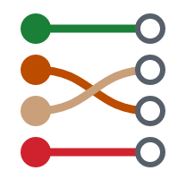
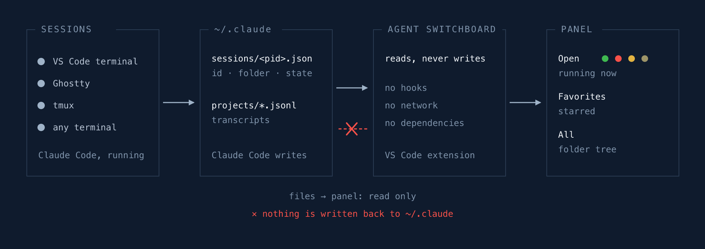
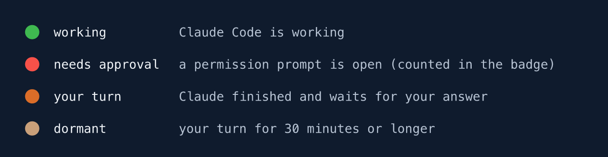

<picture>
  <source media="(prefers-color-scheme: dark)" srcset="https://github.com/SKrjwsk/vscode-agent-switchboard/raw/HEAD/assets/logo-dark.png">
  
</picture>

# Agent Switchboard

**A free (MIT), local session manager for Claude Code in VS Code: running and past sessions in one panel, read-only, with no hooks and no dependencies.**

[](https://github.com/SKrjwsk/vscode-agent-switchboard/actions/workflows/ci.yml)
[](https://github.com/SKrjwsk/vscode-agent-switchboard/releases)
[](LICENSE)

## Why

You run several Claude Code sessions at once, in VS Code, Ghostty or tmux. One of them stops at a permission prompt and waits. You find out when you come back to that terminal, and that session's work stood still until then.

A day later the work you want to continue is a session in one of many folders. You have to remember where it ran and which id to pass to `claude --resume`.

Agent Switchboard shows every session in one panel, colored by what it is doing, and resumes any of them with a double click. It reads the files Claude Code already writes: no hooks to install, nothing written to `~/.claude`, nothing sent anywhere.



<!-- demo GIF goes here instead of the diagram above: assets/demo.gif, recorded by the maintainer on synthetic sessions -->

## Install

**1. Install the ready-made file.** Download [`agent-switchboard-0.1.1.vsix`](https://github.com/SKrjwsk/vscode-agent-switchboard/raw/master/agent-switchboard-0.1.1.vsix) from this repository and run:

```bash
code --install-extension agent-switchboard-0.1.1.vsix
```

**2. Build it yourself.** From a clone of this repository:

```bash
npm ci
npm run package
code --install-extension agent-switchboard-0.1.1.vsix
```

Or paste this to your agent: *Install the VS Code extension from `https://github.com/SKrjwsk/vscode-agent-switchboard`: download `agent-switchboard-0.1.1.vsix` from the repository, install it with `code --install-extension`, then tell me to run Developer: Reload Window.*

Then run **Developer: Reload Window**. Supported on macOS and Linux with POSIX shells (sh, bash, zsh); Windows is not supported.

## First use

1. Click the Agent Switchboard icon in the activity bar. **Open** lists the Claude Code sessions running in this folder, including those started in Ghostty, tmux or any other terminal.
2. Read the icon colors: working, needs approval, your turn, dormant. A badge on the panel icon counts the sessions that need approval, even when the panel is collapsed.
3. Open **All**, find a past session in the folder tree and double click it. It resumes in an editor tab with `claude --resume`.



## Everyday use cases

- **Three agents in Ghostty.** You started three sessions in a terminal outside VS Code. One asks for permission to run a command: its icon in **Open** turns red and the badge on the panel icon shows `1`. The other two stay green while they work.
- **Whose turn is it?** Finished sessions turn orange: your turn. After 30 minutes without an answer the orange fades, so the sessions you just left stand out from the ones you forgot.
- **Back to yesterday's work.** Open **All**, find the session in the folder tree it was started in, or search by title, and double click. If the session still runs elsewhere, you are warned before a second instance writes to the same transcript.
- **What did that session do?** **Read transcript** shows a session as Markdown without resuming it, so you can check an old session without touching its history.

More: star sessions into **Favorites**, start a new named session in any folder of the tree (**Start Claude here**), search sessions by title, date or folder, and copy a resume command for another terminal. All views show only sessions from the folders open in the window; a window without a folder shows everything.

## How it works

Claude Code writes one file per running process (`~/.claude/sessions/<pid>.json`: session id, folder, state) and one transcript per session (`~/.claude/projects/*/<uuid>.jsonl`). Agent Switchboard polls them while a view is visible and matches each process to its session by id.

- **State from files, not hooks.** The `status` and `waitingFor` fields of the session file give the state, so nothing has to be installed into Claude Code.
- **Exact match.** Claude Code names the session of each pid itself, so no guessing from command-line flags.
- **Partial reads.** Transcripts grow large; the extension reads the head once and the tail on change.

Design decisions in [docs/architecture.md](docs/architecture.md).

## Settings

- `agentSwitchboard.titlePathPrefixes` — folder paths cut from session titles. With `["~/work/"]` a first prompt `fix ~/work/app/README.md` is shown as `fix app/README.md`. The home directory is always shown as `~`.

State colors can be changed in `workbench.colorCustomizations`: `agentSwitchboard.working`, `agentSwitchboard.needsApproval`, `agentSwitchboard.yourTurn`, `agentSwitchboard.dormant`.

## Security

The extension only reads local files and makes no network requests. Its only write is the list of favorite session ids in VS Code's extension storage, which Settings Sync copies to your other machines if you have it enabled.

- `~/.claude/projects/*/<uuid>.jsonl` — session transcripts: the first 256 KB (folder, first prompt) and the last 1 MB (`/rename` title); the last 4 MB of the file when you open "Read transcript"
- `~/.claude/sessions/<pid>.json` — one file per running Claude Code process (session id, folder, state). Only files named `<number>.json` are read; the same folder holds per-process key files (`<pid>.<hash>.key`), which the extension never opens
- `ps` — process list, to check that a pid really belongs to `claude` and to find the VS Code terminal it runs in
- `process.kill(pid, 0)` — signal 0 sends nothing; it only checks whether a process is still alive

Folder paths from session files never pass through a shell: terminals get them as the `cwd` option. Session ids are accepted only in UUID format; names and copied commands are single-quoted. The transcript preview treats the transcript as untrusted: `[`, `]` and `<` are escaped outside code blocks, so links, images and HTML from an answer are not rendered.

## Limitations

- Session files are an internal, undocumented Claude Code format, tested on Claude Code 2.1.312. A Claude Code version that does not write `~/.claude/sessions/<pid>.json` leaves **Open** empty with a message above it; **Favorites** and **All** keep working, they read only transcripts
- The states come from the `status` and `waitingFor` fields of the session files, checked on Claude Code 2.1.312: `waitingFor` was seen with the value `permission prompt`; any other value, or none, also counts as needs approval. A session idle for 30 minutes or longer turns dormant on the next refresh
- The extension reads `~/.claude`; a different location set with Claude Code's `CLAUDE_CONFIG_DIR` is not supported
- Supported on macOS and Linux with POSIX shells (sh, bash, zsh). The copied resume command and the quoting of session names are not meant for fish or cmd.exe; Windows is not supported
- Sessions running outside VS Code cannot be focused from the panel
- Terminal tabs do not change color with the session state: VS Code sets a terminal's icon and color only when it is created
- Double click is emulated (two clicks within 500 ms); tree views have no double-click event
- A workspace opened through a symbolic link does not match sessions recorded under the real path
- A `/rename` title older than the last 1 MB of a transcript is lost after a VS Code restart; the title falls back to the first prompt

## License

[MIT](LICENSE) · [Changelog](CHANGELOG.md)
